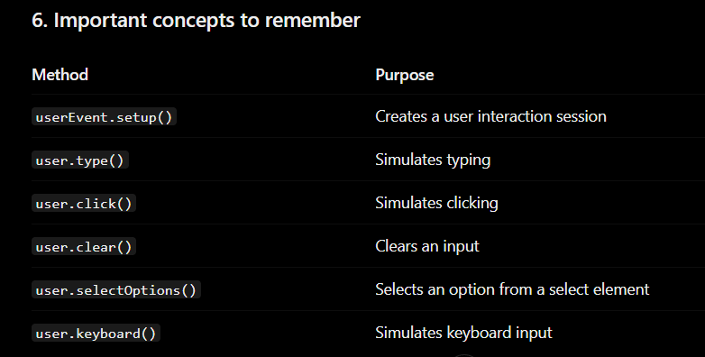

## React Testing Library
- Render UI in a simulated browsers
- allow to interact just like user
- 3 IMPORTANT FUNCTIONS:
- Function	Purpose
render()	Renders a React component
screen	Finds elements on the rendered page
expect()	Checks whether something is correct

1. getByRole()
screen.getByRole('button', { name: 'Login' });

Finds an element based on its accessible role and name.

Examples:
screen.getByRole('button', { name: 'Login' });

screen.getByRole('heading', { name: 'Welcome' });

screen.getByRole('textbox', { name: 'Email' });

2. getByText()
screen.getByText('Welcome to our store');

Finds an element containing the specified text.

Useful for:
- Product descriptions.
- Error messages.
- Notifications.
- Informational text.

3. getByLabelText()
screen.getByLabelText('Email');

Finds a form control associated with a label.

This is particularly useful for testing forms.

4. getByTestId()
screen.getByTestId('product-price');

Finds an element using a custom data-testid attribute.

Example:

$29.99

Use this when an element cannot be reliably identified through its accessible role, label, or text.

Don't make data-testid your default way of finding elements.

5. Understand the difference between getBy, queryBy, and findBy
This is particularly important.
Query	Behavior	When to use
getBy	Returns element or throws immediately	Element should exist
queryBy	Returns element or null	Checking absence
findBy	Returns a Promise	Element appears asynchronously

- Can add timeout option to prolong the getters ex: findBy('', {}, {timeout: 3000})
- in form validation, despite using await on user event, the form is still synchronous so no need to use findByText, unless the poeration is Async
6. What is userEvent?

React Testing Library provides userEvent through a separate package.

It simulates user interactions, such as:
- Clicking buttons.
- Typing into inputs.
- Selecting options.
- Tabbing between elements.
First, import it:
import userEvent from '@testing-library/user-event';

1. mock function
Consider:
const mockAddToCart = vi.fn();

This creates a mock function.

A mock function allows us to track:
- Whether a function was called.
- How many times it was called.
- What arguments were passed to it.

8. Testing forms
- getByLabelText('label name'): get the inputs associate with the labels, make sure the label and the input connected via htmlFor attribute

9. Test API call with MSW
- Why do we need these three lifecycle methods?
    **Method**	    **Purpose**
    beforeAll	Start the mock server
    afterEach	Reset handlers so tests don't affect each other
    afterAll	Shut down the mock server

    **Important**: Your existing Vitest configuration should already point to ./src/test/setup.ts. You don't need to change it if that's still the case.
10.  Override exsisting handler for paritcular testing
- server.use('handler )
- will over ride the defined handler 
- make sure to call server.resetHandlers() afterEach so that the overid edoes not affect other test

11. wait for condition or callback to be true
- waitFor()
- waitForElementToBeRemoved when waiting for an existing element to disappear.
- Sometimes you're not waiting for an element to appear. Instead, you're waiting for a condition or callback to become true.
ex: 
    import { waitFor } from '@testing-library/react';

    await waitFor(() => {
    expect(mockFunction).toHaveBeenCalled();
    });
- default timeout for these are 1000ms

12. Integeration testing
- Test to make sure that everything is working together as a whole.